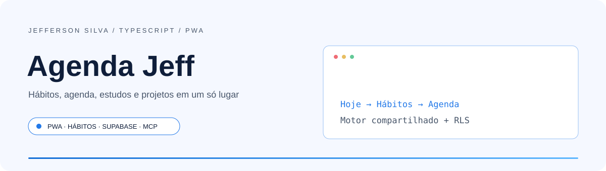
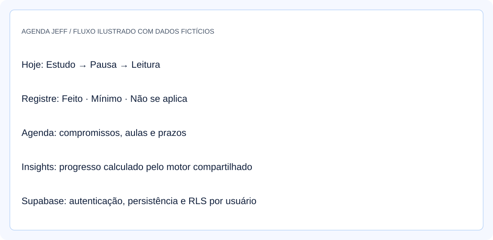
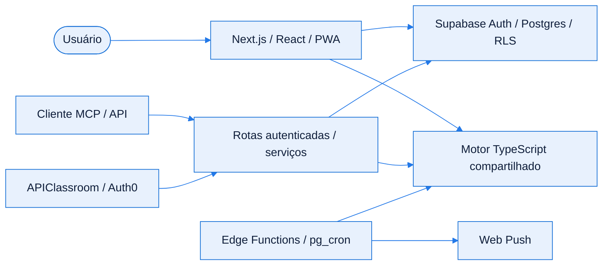
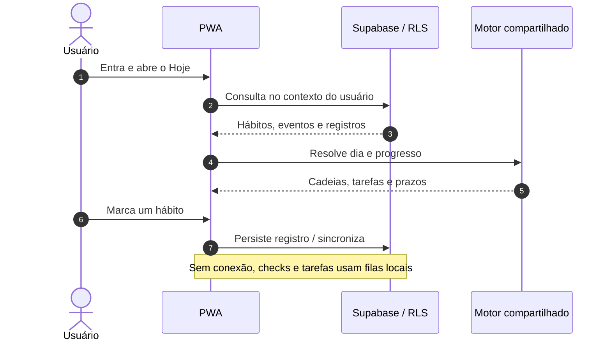
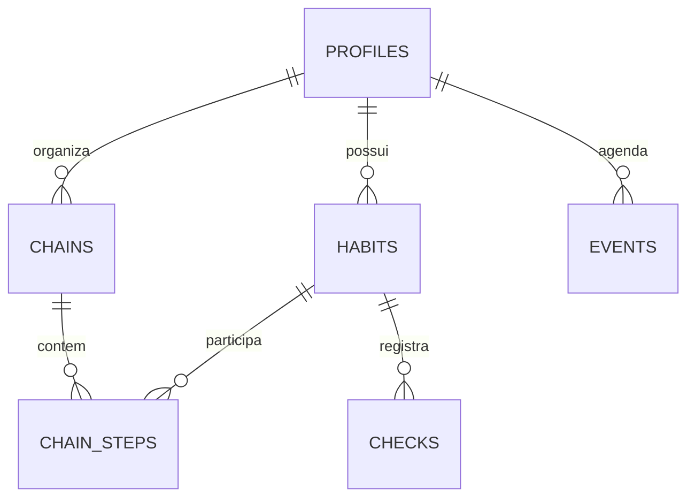

<!-- Jefferson Silva / README 4.0 — adaptado ao código de Agenda Jeff. -->

<div align="center">

<picture>
  <source media="(prefers-color-scheme: dark)" srcset="./assets/banner-dark.svg" />
  <source media="(prefers-color-scheme: light)" srcset="./assets/banner-light.svg" />
  
</picture>

<br />
<br />

**Hábitos, agenda, estudos e projetos em uma PWA com integrações de IA.**

<p>
  <a href="#inicio-rapido"></a>
  <a href="https://github.com/jeffsilva03/agendajeff-public/issues/new"></a>
</p>

[](https://github.com/jeffsilva03/agendajeff-public/commits/)
[](https://github.com/jeffsilva03/agendajeff-public)
[](https://github.com/jeffsilva03/agendajeff-public)
[](https://github.com/jeffsilva03/agendajeff-public/issues)
[](https://github.com/jeffsilva03/agendajeff-public/stargazers)

<a href="#stack">
  <picture>
    <source media="(prefers-color-scheme: dark)" srcset="https://skillicons.dev/icons?i=ts,nextjs,react,supabase,tailwind&theme=dark" />
    
  </picture>
</a>

<br />
<br />

<a href="#visao-geral">Visão geral</a> &nbsp;•&nbsp;
<a href="#demonstracao">Demonstração</a> &nbsp;•&nbsp;
<a href="#funcionalidades">Funcionalidades</a> &nbsp;•&nbsp;
<a href="#stack">Stack</a> &nbsp;•&nbsp;
<a href="#arquitetura">Arquitetura</a> &nbsp;•&nbsp;
<a href="#inicio-rapido">Instalação</a> &nbsp;•&nbsp;
<a href="#exemplos">Exemplos</a> &nbsp;•&nbsp;
<a href="#roadmap">Roadmap</a> &nbsp;•&nbsp;
<a href="#contribuir">Contribuir</a>

</div>

<br />

> [!NOTE]
> **Status:** Versão pública de portfólio com módulos implementados, integrações configuráveis e testes com dados fictícios. Histórico inicial independente, sem os commits do projeto de produção.

> [!TIP]
> **Versão pública de portfólio:** esta cópia tem histórico próprio e usa exemplos fictícios. A aplicação em produção é gerenciada separadamente. Consulte [Sobre esta versão pública](./docs/versao-publica.md).

<a id="visao-geral"></a>
## ✦ Visão geral

**Agenda Jeff** é uma PWA para acompanhar hábitos em cadeia, compromissos, estudos, projetos e trabalho freelance. O frontend usa Next.js e React, com Supabase para autenticação e persistência. Um motor TypeScript compartilhado calcula o dia, prazos, lembretes e indicadores para as telas, Edge Functions e integrações.

<table>
<tr>
<td width="33%" valign="top">

**🧩 Problema**

Hábitos, tarefas, aulas e projetos competem pelo mesmo tempo e costumam ficar espalhados.

</td>
<td width="33%" valign="top">

**🛠️ Solução**

Reúne planejamento diário, semanal e mensal, com progresso, agenda e integrações de consulta.

</td>
<td width="33%" valign="top">

**📈 Resultado**

Código com motor compartilhado, sincronização, filas offline, notificações e suíte de testes automatizados.

</td>
</tr>
</table>

<a id="demonstracao"></a>
## ◐ Demonstração

<div align="center">

<picture>
  <source media="(prefers-color-scheme: dark)" srcset="./assets/screenshot-dark.svg" />
  
</picture>

<sub>Ilustração do fluxo com dados fictícios; não é uma captura da conta pessoal.</sub>

</div>

<details>
<summary><b>▶ Ver o fluxo em ação</b></summary>

Rode o projeto com Supabase local, crie uma conta de teste e cadastre hábitos e tarefas. O seed opcional usa um arquivo local ignorado pelo Git; os testes usam exclusivamente `tests/fixtures/dados-exemplo.json`.

</details>

<a id="funcionalidades"></a>
## ◈ Funcionalidades

<sub>✅ Implementado &nbsp; 🚧 Parcial &nbsp; 🗓️ Planejado</sub>

| Módulo | O que faz | Estado |
| :-- | :-- | :-- |
| **Hoje e hábitos** | Cadeias, flexíveis, feito/mínimo, histórico, foco e mapa de calor | ✅ |
| **Agenda e planejamento** | Semana, mês, recorrências, metas, revisão e feed ICS | ✅ |
| **Faculdade** | Semestres, grade, avaliações, faltas e atividades Classroom | ✅ |
| **Carreira e projetos** | Freelas, candidaturas, ideias, features e próximos passos | ✅ |
| **PWA e offline** | Instalação, cache, filas de checks e tarefas, Web Push e widgets | ✅ |
| **Integrações** | API REST somente leitura, MCP/OAuth e APIClassroom | ✅ |
| **Ambiente completo de demonstração** | Exige configurar Supabase e serviços opcionais; não há conta pública de demonstração | 🚧 |

<details>
<summary><b>▶ Regras de negócio e validações</b></summary>

| Regra | Comportamento |
| :-- | :-- |
| Cadeias | Consideram dias da semana, janelas de horário e dependência de aula |
| Dias sem aula | Exceções e feriados alteram aulas e hábitos flexíveis |
| Progresso | Mínimo conta como feito; não se aplica fica fora da adesão |
| Dados do usuário | Consultas autenticadas e políticas RLS no Postgres |
| Clientes OAuth externos | Leitura depende das integrações habilitadas pelo usuário |
| Classroom | Planejamento e resolução local não alteram a entrega oficial no Classroom |

</details>

<a id="stack"></a>
## ⚙ Stack e decisões técnicas

| Camada | Tecnologia | Por que foi escolhida |
| :-- | :-- | :-- |
| Linguagem | TypeScript | Tipos compartilhados entre interface e motor |
| Aplicação | Next.js 16.4.0 / React 19.3.0 | App Router, páginas e rotas HTTP |
| Interface | Tailwind CSS 4 / Radix / shadcn / Framer Motion | Componentes e interações responsivas |
| Dados | Supabase / Postgres / Auth / RLS / Realtime | Persistência, autenticação e sincronização por usuário |
| Agendamento | Edge Functions / pg_cron / Web Push | Execução e entrega de lembretes |
| Integrações | MCP / OAuth / Zod | Ferramentas de leitura autenticadas e parâmetros validados |
| Qualidade | Vitest / Playwright / ESLint | Testes de regras, API, ponta a ponta e análise estática |

> [!TIP]
> As versões declaradas e os comandos ficam em `package.json`; `package-lock.json` preserva a resolução das dependências.

<a id="arquitetura"></a>
## ⬡ Arquitetura



<details>
<summary><b>▶ Responsabilidade de cada componente</b></summary>

| Componente | Responsabilidade |
| :-- | :-- |
| `app/` | Páginas, API, OAuth e endpoint MCP |
| `components/` | Telas e componentes de interface |
| `lib/` | Consultas, mutações, autenticação e integrações |
| `supabase/functions/_shared/motor/` | Regras puras de dia, prazos e indicadores |
| `supabase/migrations/` | Schema, funções SQL, RLS e evolução dos dados |
| `public/sw.js` | Cache e comportamento da PWA |
| `tests/fixtures/` | Cenário fictício separado dos dados pessoais |

</details>

<details>
<summary><b>▶ Fluxo principal passo a passo</b></summary>



</details>

<details>
<summary><b>▶ Modelo de dados</b></summary>



Recorte conceitual. O schema completo inclui faculdade, tarefas, freelas, candidaturas, projetos, notificações e integrações; veja as migrations.

</details>

<a id="inicio-rapido"></a>
## ⚡ Início rápido

**Pré-requisitos**

| Ferramenta | Versão | Como verificar |
| :-- | :-- | :-- |
| Node.js | 22+ | `node --version` |
| npm | Compatível com Node 22 | `npm --version` |
| Docker Desktop | Engine Linux em execução | `docker info` |
| Supabase CLI | Dependência de desenvolvimento do projeto | `npx supabase --version` |

<details open>
<summary><b>Windows · PowerShell</b></summary>

```powershell
git clone https://github.com/jeffsilva03/agendajeff-public.git
cd agendajeff-public
npm ci
npx supabase start
Copy-Item .env.example .env.local
# Preencha .env.local com a URL e as chaves do Supabase LOCAL.
npm run dev
```

</details>

<details>
<summary><b>▶ Linux / macOS</b></summary>

```bash
git clone https://github.com/jeffsilva03/agendajeff-public.git
cd agendajeff-public
npm ci
npx supabase start
cp .env.example .env.local
# Preencha .env.local com a URL e as chaves do Supabase LOCAL.
npm run dev
```

Sequência documentada, não executada neste ambiente.

</details>

> [!TIP]
> Abra **http://localhost:3000/entrar** e crie uma conta local. Os e-mails de teste chegam em **http://localhost:54324**. O uso básico começa com dados vazios.

**Variáveis de ambiente**

Copie [.env.example](./.env.example) e configure somente as integrações que usar.

| Variável | Obrigatória | Padrão | Descrição |
| :-- | :-- | :-- | :-- |
| `NEXT_PUBLIC_SUPABASE_URL` | Sim | Local no exemplo | URL do seu projeto Supabase |
| `NEXT_PUBLIC_SUPABASE_PUBLISHABLE_KEY` | Sim | Placeholder | Chave publicável do projeto |
| `SUPABASE_SECRET_KEY` | Seed / feed ICS | Placeholder | Chave privilegiada usada somente no servidor |
| `NEXT_PUBLIC_VAPID_PUBLIC_KEY` | Push | Placeholder | Chave pública; privada só nas Edge Functions |
| `CRON_SECRET` | Agendamentos | — | Segredo dos disparos automáticos |
| `MCP_RESOURCE_URL` / `SUPABASE_JWT_ISSUER` | Integrações | Derivados quando ausentes | Recurso MCP e emissor OAuth |
| `CLASSROOM_AUTH0_*` / `CLASSROOM_TOKEN_KEY` | Classroom | — | OAuth e cifra dos tokens; veja a documentação |
| `DEV_ALLOWED_ORIGINS` | — | Vazio | IPs/hosts adicionais, sem protocolo nem porta, só no desenvolvimento |

> [!IMPORTANT]
> Não versione `.env.local`, `supabase/.env` ou `dados_iniciais.json`. Seeds e verificações de RLS exigem uma chave privilegiada: use um projeto local dedicado. Esta cópia pública não inclui o histórico nem os arquivos pessoais do projeto de produção.

<details>
<summary><b>▶ Problemas comuns</b></summary>

| Sintoma | Causa provável | Como resolver |
| :-- | :-- | :-- |
| Supabase não inicia | Docker parado | Inicie o Docker Desktop e confira `docker info` |
| Login sem código | E-mail local em caixa de teste | Abra a caixa local na porta 54324 |
| Seed sem arquivo | Dados pessoais não são distribuídos | Opcionalmente copie a fixture fictícia para `dados_iniciais.json` |
| Celular não acessa em dev | Host não autorizado / URL inacessível | Configure `DEV_ALLOWED_ORIGINS` e a URL local do Supabase |
| Push não chega | VAPID, agendamento ou instalação incompletos | Confira a configuração dos lembretes e os logs |
| Classroom não conecta | OAuth ainda não configurado | Siga `docs/CLASSROOM_INTEGRACAO.md` |

</details>

<a id="exemplos"></a>
## ◉ Exemplos de uso

<details open>
<summary><b>▶ Cenário principal</b></summary>

1. Crie uma conta local em `/entrar`.
2. Cadastre uma cadeia e hábitos em `/habitos`.
3. Marque os passos em `/hoje`; planeje compromissos em `/agenda`.
4. Consulte progresso em `/insights` e organize projetos em `/projetos`.

Seed opcional, com cenário fictício, para uma conta em banco local dedicado:

```powershell
Copy-Item tests/fixtures/dados-exemplo.json dados_iniciais.json
npm run seed -- pessoa@example.com
```

Crie a conta com esse e-mail antes do seed. O comando é idempotente e não cria checks nem freelas.

</details>

<details>
<summary><b>▶ Endpoints da API</b></summary>

| Método | Rota | Descrição | Autenticação |
| :-- | :-- | :-- | :-- |
| `GET` | `/api/integrations/agenda/v1/today` | Resumo do dia | Sessão / Bearer |
| `GET` | `/api/integrations/agenda/v1/habits` | Hábitos e progresso | Sessão / Bearer |
| `GET` | `/api/integrations/agenda/v1/projects` | Projetos | Sessão / Bearer |
| `GET` | `/api/integrations/agenda/v1/tasks` | Tarefas | Sessão / Bearer |
| MCP | `/mcp` | Ferramentas de consulta | OAuth / Bearer |

A API de integração é somente leitura. Veja o contrato completo em [OpenAPI](./docs/openapi.yaml) e os fluxos em [API de integração](./docs/API_INTEGRACAO.md).

```powershell
# Token de uma sessão LOCAL de teste, recebido pelo Supabase Auth.
$headers = @{ Authorization = "Bearer $env:AGENDA_ACCESS_TOKEN" }
Invoke-RestMethod -Uri 'http://localhost:3000/api/integrations/agenda/v1/today' -Headers $headers
```

</details>

<details>
<summary><b>▶ Testes e qualidade</b></summary>

| Comando | O que faz |
| :-- | :-- |
| `npm test` | Testes unitários do motor e API com fixture fictícia |
| `npm run typecheck` | Gera tipos de rotas e verifica TypeScript |
| `npm run lint` | Executa ESLint |
| `npm run build` | Compila a aplicação |
| `npm run test:e2e` | Playwright com Supabase local; cria e apaga usuário de teste |
| `npm run test:e2e:prod` | Build e E2E de produção via Bash |

A suíte E2E exige infraestrutura local e deve usar projeto dedicado. Resultados desta revisão em [Validação da documentação](./docs/validacao-readme.md).

</details>

<a id="roadmap"></a>
## ◇ Roadmap

- [x] Centralizar regras no motor TypeScript compartilhado
- [x] Implementar PWA, hábitos, agenda, faculdade e projetos
- [x] Expor consultas autenticadas por API e MCP
- [x] Separar dados pessoais das fixtures de testes
- [x] Criar versão pública independente, sem histórico ou arquivos pessoais
- [ ] Revisar alertas das dependências e automatizar verificações em CI

<sub>Os itens pendentes são sugestões de evolução, sem prazo definido. Acompanhe e sugira melhorias nas <a href="https://github.com/jeffsilva03/agendajeff-public/issues">issues</a>.</sub>

<a id="documentacao"></a>
## ▤ Documentação

<details>
<summary><b>▶ Estrutura de pastas</b></summary>

```text
agendajeff-public/
├── app/                        # páginas, rotas HTTP, OAuth e MCP
├── components/                 # interface por módulo
├── lib/                        # dados, serviços e integrações
├── supabase/
│   ├── functions/_shared/motor/ # regras compartilhadas
│   └── migrations/             # schema e RLS
├── tests/
│   ├── fixtures/               # somente dados fictícios
│   ├── motor/                  # regras de negócio
│   ├── api/                    # contratos e validações
│   └── e2e/                    # fluxos ponta a ponta
├── docs/                       # integrações, auditoria e validação
├── assets/                     # banners e ilustrações nos dois temas
├── public/                     # PWA, ícones e widgets
├── .env.example
├── package.json
└── README.md
```

Documentação: [Funcionalidades](./FUNCIONALIDADES.md) · [API](./docs/API_INTEGRACAO.md) · [ChatGPT/MCP](./docs/INTEGRACAO_CHATGPT.md) · [Classroom](./docs/CLASSROOM_INTEGRACAO.md) · [Widgets](./docs/WIDGETS.md).

</details>

<details>
<summary><b>▶ Perguntas frequentes</b></summary>

**Preciso conectar o Classroom para usar o app?**
Não. É uma integração opcional, com configuração própria.

**O README inclui dados da conta pessoal?**
Não. Esta cópia não inclui seed pessoal ou histórico anterior. Os testes usam um cenário fictício; qualquer arquivo local com seus dados deve permanecer ignorado pelo Git.

**O app funciona totalmente offline?**
Há cache e filas para checks e tarefas; autenticação e serviços externos dependem de conexão.

**Existe licença de uso?**
Não há arquivo de licença; nenhuma licença foi presumida.

</details>

<details>
<summary><b>▶ Limitações e segurança</b></summary>

- **Limitações:** notificações, Classroom, OAuth e agendamento exigem configuração externa.
- **Segurança:** a aplicação usa autenticação e RLS; a chave privilegiada deve permanecer somente no servidor. Esta revisão não equivale a um pentest.
- **Publicação:** cópia independente, sem o histórico de produção; consulte a [auditoria](./docs/auditoria-portfolio.md). As dependências ainda têm os alertas registrados na validação.
- **Reportar vulnerabilidade:** combine um canal privado com o autor antes de enviar detalhes ou credenciais.

</details>

<a id="contribuir"></a>
## ⇄ Contribuir

1. Faça um fork e crie uma branch: `git checkout -b feat/minha-melhoria`
2. Faça commits seguindo o padrão abaixo
3. Rode `npm test`, `npm run typecheck`, `npm run lint` e `npm run build`, confira os fluxos alterados e execute os testes disponíveis antes de abrir o PR
4. Abra um Pull Request descrevendo o que mudou e por quê

<details>
<summary><b>▶ Padrão de commits</b></summary>

| Prefixo | Quando usar | Exemplo |
| :-- | :-- | :-- |
| `feat` | Nova funcionalidade | `feat: adiciona filtro por data` |
| `fix` | Correção de bug | `fix: corrige cálculo do total` |
| `docs` | Só documentação | `docs: atualiza instalação` |
| `refactor` | Mudança interna sem alterar comportamento | `refactor: separa serviço de e-mail` |
| `test` | Testes | `test: cobre fluxo de login` |
| `chore` | Configuração e manutenção | `chore: atualiza dependências` |

</details>

## ◎ Autor

<table>
<tr>
<td align="center" width="140">
  <a href="https://github.com/jeffsilva03"></a>
</td>
<td>

**Jefferson Silva**<br />
Autor de Agenda Jeff<br />
PWA com Next.js, Supabase e um motor TypeScript compartilhado.

<a href="https://github.com/jeffsilva03"></a>

</td>
</tr>
</table>

---

<div align="center">

Se este projeto foi útil, considere deixar uma ⭐ — isso ajuda outras pessoas a encontrá-lo.

<br />

<a href="#visao-geral"></a>

<sub>TypeScript &nbsp;•&nbsp; Next.js &nbsp;•&nbsp; Supabase</sub>

</div>
